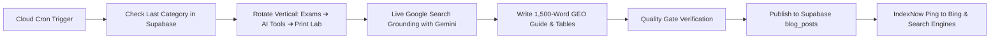

# Kagazo 48-Hour Autonomous Blog & GEO Publishing Engine

Welcome to the **Kagazo Autonomous Publishing System**. This engine automatically researches live trending queries on Google, generates comprehensive 1,500+ word technical guides following the **Kagazo GEO standard**, publishes directly to your live Supabase database, and pings search engine crawlers (Bing, Yahoo, Perplexity, Google) for instant indexing.

---

## 1. Quick Setup (Only 1 Step)

### Step 1: Add your Free Google Gemini API Key
1. Get a **100% free Gemini API Key** from [Google AI Studio](https://aistudio.google.com/).
2. Open your local `.env.local` file and paste it on line 39:
   ```env
   GEMINI_API_KEY=your_gemini_api_key_here
   ```

### Step 2: Add Secrets to GitHub (For 48-Hour Cloud Automation)
To let GitHub Actions run automatically every 48 hours in the background:
1. Go to your GitHub repository: `Settings` → `Secrets and variables` → `Actions`.
2. Click **New repository secret** and add:
   - `GEMINI_API_KEY`: *(Your Google AI Studio API key)*
   - `SUPABASE_SERVICE_ROLE_KEY`: *(From your `.env.local`)*
   - `NEXT_PUBLIC_SUPABASE_URL`: `https://slfiqegofbgsuolltslc.supabase.co`

---

## 2. How the 48-Hour Flow Works

Every 48 hours at **2:30 AM IST (21:00 UTC)**, the cloud runner executes:



### Rotating Verticals:
1. **Govt Exams & Compliance:** TNPSC OTR, SSC CGL webcam photos, UPSC date stamper, IBPS declaration, e-Sevai patta chitta 200KB compressor.
2. **In-Browser AI Utilities:** Unlimited free background remover vs Remove.bg, AI formal attire changer, signature cleaner, ATS resume maker.
3. **Print & Cyber Café:** 8-photo 4x6 sheet printing for Epson L805 & Canon, dual-sided PVC card alignment, Aadhaar/PAN single-sheet KYC merge.

---

## 3. Running On-Demand from your Computer

You can test or trigger the engine anytime locally from your terminal:

```bash
# 1. Preview without saving to database (Dry Run)
npm run auto-blog -- --dry-run

# 2. Publish an automated live post immediately
npm run auto-blog

# 3. Force a specific category
npm run auto-blog -- --category ai          # Forces In-Browser AI Tools guide
npm run auto-blog -- --category exam        # Forces Government Exam guide
npm run auto-blog -- --category print       # Forces Cyber Café printing manual

# 4. Write about a specific breaking topic right away
npm run auto-blog -- --topic "TNPSC Group 4 2026 Hall Ticket Photo Size & Date Rules"
```

---

## 4. Quality & Compliance Safeguards (AdSense & SEO Protected)

Every single post generated by this engine must pass strict validation before insertion:
* **Word Count:** Strictly 1,200 to 1,800 words (rejects thin content).
* **GEO Answer Capsules:** 40–50 word bolded summary under every `H2` for direct quotation in Google AI Overviews and Perplexity.
* **Structured Data Tables:** Compares official portal requirements vs Kagazo calibration vs common upload error codes.
* **Tool Interlinking:** Automatically links directly to the matching Kagazo utility in the first 75 words.
* **Author Transparency:** Signed and structured under schema as `Arulraj, Founder & Lead Engineer at Kagazo`.
* **Zero AI Clichés:** Automatically scans for and prevents generic filler phrases.

---

## 5. Instant Search Engine Indexing

* **Next.js Sitemap:** Automatically included dynamically in `https://kagazo.in/sitemap.xml`.
* **IndexNow Protocol:** Pings `api.indexnow.org` immediately upon insertion using your verified key `kagazo2026indexnow`.
* **OpenGraph Social Preview:** Dynamic 1200×630 cards generated automatically via `/api/og?title=...&type=blog`.
